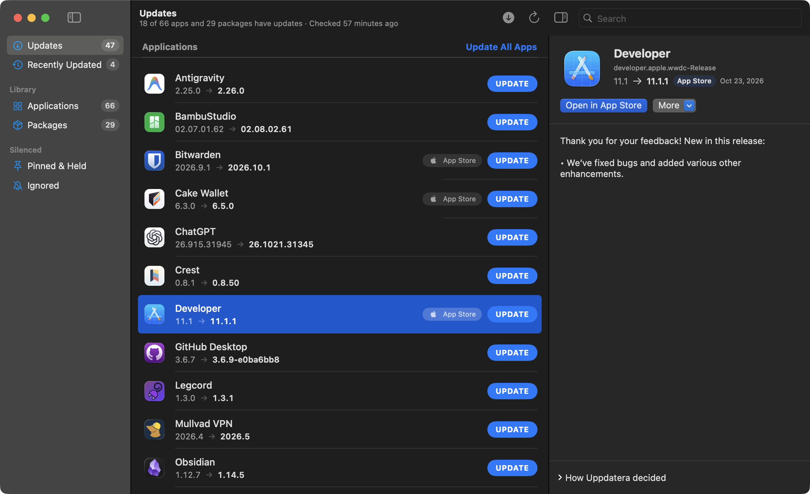

# Uppdatera

A free macOS updater for every app in `/Applications`, and for the packages your command-line tools installed.



**[Download the latest version](https://github.com/klppl/uppdatera/releases/latest/download/Uppdatera.dmg)** · macOS 14 or later · [All releases](https://github.com/klppl/uppdatera/releases)

## What it does

- Finds updates through each app's own feed, the vendor's site, GitHub, the App Store or Homebrew, and shows how it decided.
- Installs them safely: the download must be notarized by Apple and signed by the same developer as the installed app. The old copy goes to the Trash.
- Updates Homebrew, npm, pnpm, bun, Go, Cargo, uv, pipx and RubyGems packages too.
- Checks in the background and lets you skip, pin or ignore any app.

## Rules

Apps that need help are covered by [`rules/rules.json`](rules/rules.json), shared by everyone and fetched without a new release. Your own rules go in `~/Library/Application Support/Uppdatera/rules.json`. See [CONTRIBUTING.md](CONTRIBUTING.md) to add or fix one.

## Build from source

```bash
./scripts/build-app.sh && open build/Uppdatera.app
```

It also runs without the window, for example `swift run Uppdatera --check --verbose` or
`swift run Uppdatera --test-rule com.vendor.App 1.0`. Tests: `swift test`.

## License

[The Lagom License](LICENSE). Not too much, not too little.
